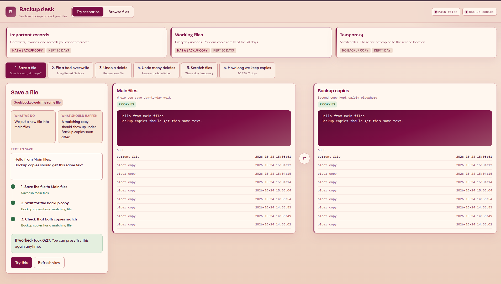
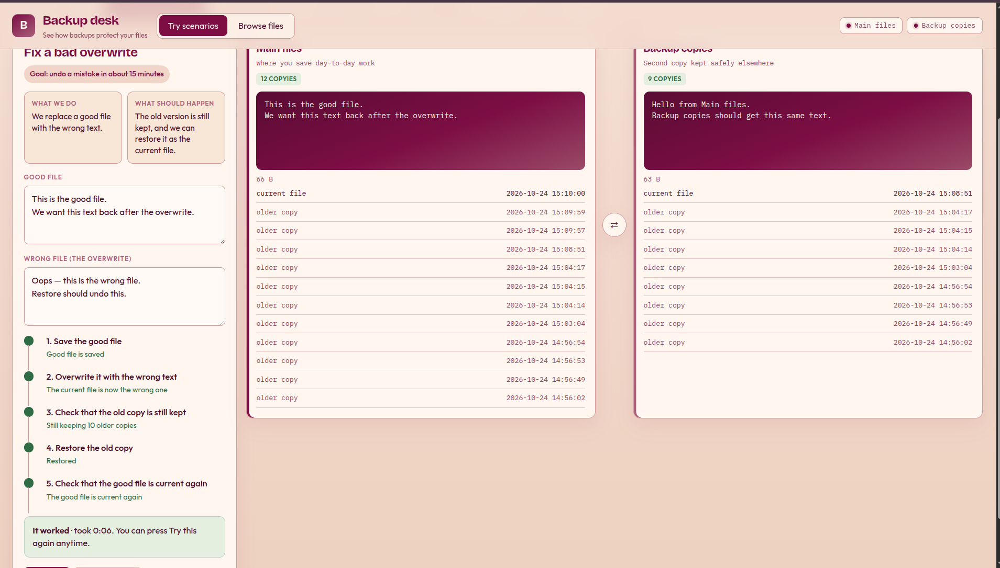
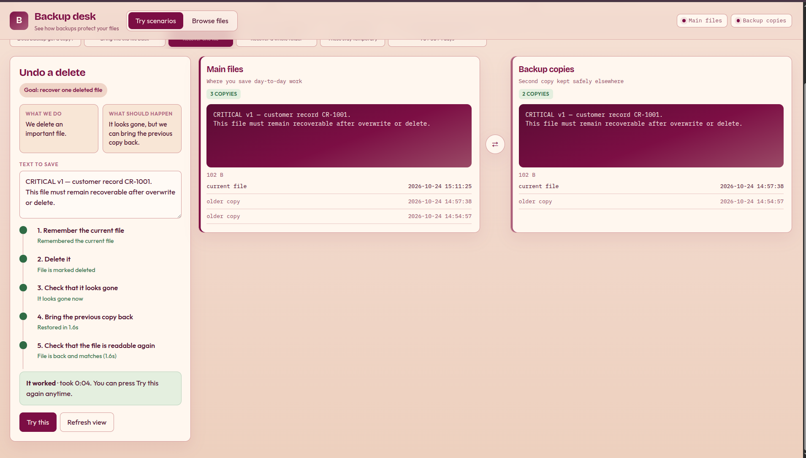
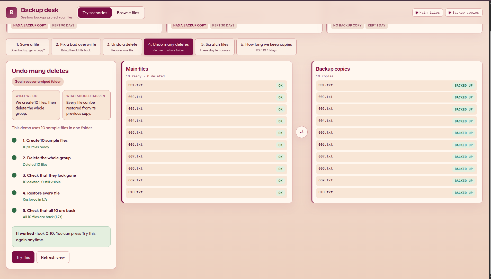
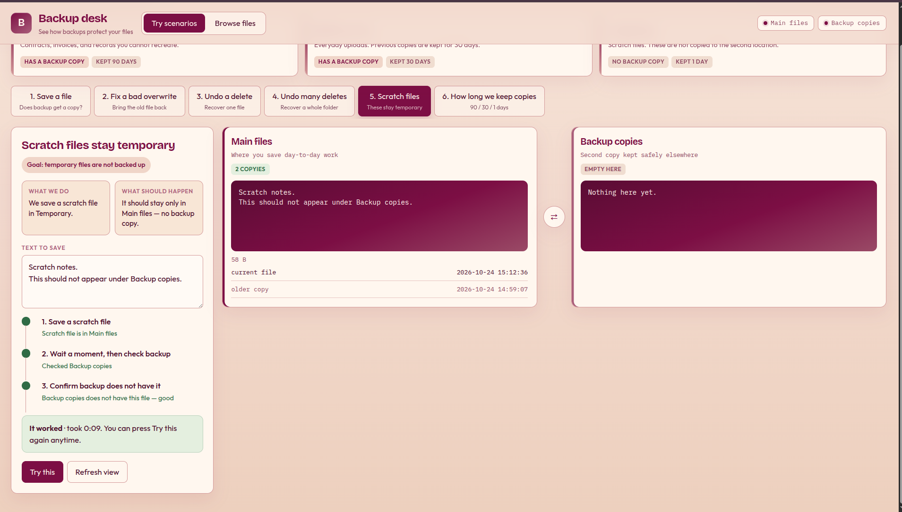
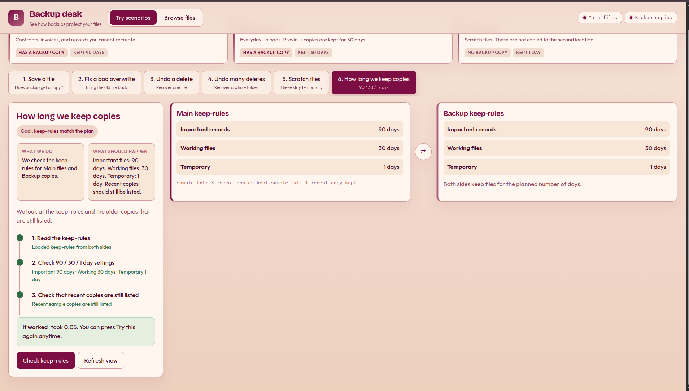

# Automated S3 Backup and Recovery

Versioned S3 storage with cross-region backup, so you can undo overwrites and deletes, and still have a copy if one region is unavailable.

- **Main bucket** in `us-east-1` — where files are written
- **Backup bucket** in `us-west-2` — replica of `critical/` and `app-data/`
- **Versioning** on both buckets — older copies stay after overwrite or delete
- **Local dashboard** — walk through backup and recovery scenarios against the live buckets

## What is protected

| Folder | What it is for | Kept how long | Backed up? |
|--------|----------------|---------------|------------|
| `critical/` | Records you cannot recreate | 90 days of older versions | Yes → `us-west-2` |
| `app-data/` | Everyday working files | 30 days of older versions | Yes → `us-west-2` |
| `temp/` | Scratch / short-lived files | Current object only (1-day min for noncurrent) | No |

## Recovery targets

| Situation | Goal |
|-----------|------|
| Accidental overwrite of one file | Restore within **15 minutes** |
| Accidental delete of one file | Restore within **15 minutes** |
| Wipe of many files (up to 100) | Restore within **1 hour** |
| `us-east-1` unavailable | Use the backup bucket; accept up to **15 minutes** of lag |

Details: [docs/01-recovery-requirements.md](docs/01-recovery-requirements.md)

## Project layout

```
bin/backup-sys.ts          CDK app entry
lib/backup-sys-stack.ts    Source bucket + replication (us-east-1)
lib/backup-bucket-stack.ts Backup bucket + KMS key (us-west-2)
lib/retention.ts           Lifecycle rules
sample-data/               Seed files deployed into the source bucket
ui/                        Local scenario dashboard
docs/                      Recovery requirements
test/                      CDK unit tests
```

## Prerequisites

- Node.js 18+
- AWS CLI configured with an account that can create S3, KMS, IAM, and CloudFormation resources
- AWS CDK CLI (`npx cdk` is enough; no global install required)

## Setup

```bash
npm install
npm test
```

Bootstrap each region once per account (if not already done):

```bash
npx cdk bootstrap aws://ACCOUNT_ID/us-east-1
npx cdk bootstrap aws://ACCOUNT_ID/us-west-2
```

## Deploy

```bash
npx cdk deploy --all
```

This creates:

1. `BackupBucketStack` in `us-west-2` — versioned backup bucket encrypted with a customer-managed KMS key
2. `BackupSysStack` in `us-east-1` — versioned source bucket, replication of `critical/` and `app-data/`, and sample data upload

Stack outputs include the source and backup bucket names.

## Scenario dashboard

After deploy, run the local UI against the live buckets:

```bash
npm run ui
```

Open [http://127.0.0.1:4173](http://127.0.0.1:4173).

The dashboard resolves bucket names from CloudFormation outputs (or from `SOURCE_BUCKET` / `DEST_BUCKET` env vars) and walks through:

1. **Save a file** — upload to the main bucket; wait for the backup copy

   

2. **Fix a bad overwrite** — replace a file, then restore the older copy

   

3. **Undo a delete** — delete `critical/sample.txt`, then restore it

   

4. **Undo many deletes** — wipe and restore a small group of files

   

5. **Scratch files** — confirm `temp/` is not copied

   

6. **How long we keep copies** — check the 90 / 30 / 1 day keep-rules

   

There is also a **Browse files** view for listing keys, older copies, and restoring one by hand.

Uses your local AWS credentials. Keep it on localhost; it can write and delete objects in the deployed buckets.

## Tests

```bash
npm test
```

Unit tests assert versioning, encryption, replication rules, and retention windows in the synthesized CloudFormation templates.

## Clean up

```bash
npx cdk destroy --all
```

Buckets are set to destroy with the stacks and auto-delete objects. Confirm before destroying if you still need the data.
